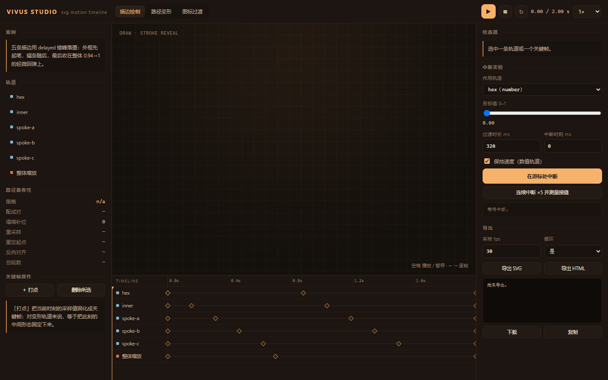

# vivus studio

**把 vivus 的「一次性描边动画」扩展成关键帧时间轴工作台。**
描边绘制 · 路径变形 · 图标过渡，一条时间轴编排，导出**不依赖 JavaScript** 的独立 SVG。

[▶ 打开编辑器](https://llinok111.github.io/vivus-studio/studio/) · [案例画廊](https://llinok111.github.io/vivus-studio/demo/) · [上游 vivus 演示](https://llinok111.github.io/vivus-studio/demo/upstream.html)

> 这是 [maxwellito/vivus](https://github.com/maxwellito/vivus)（MIT，15.4k★）的二次开发版本。
> 上游 174 次提交历史完整保留，`src/vivus.js` 与 `src/pathformer.js` **逐字节未改动**
> （`git hash-object` 与上游 blob 一致），上游 89 个 Karma 测试用**上游原命令**跑通。
> 新增代码全部在 `src/motion/`、`studio/`、`test/`、`tools/`。



*左侧案例与兼容性报告，中间舞台，右侧关键帧检查器与中断实验台，底部时间轴。*

---

## 为什么做这个

上游 vivus 解决的是「页面加载时把 SVG 描一遍」：给它一个 SVG，它用 `stroke-dashoffset` 把路径画出来。
能力边界很清楚——**一次、单向、不可擦洗、没有形状变化**。

而在做图标动效时，真正需要的是一张时间轴：线稿淡出、图形变形、图标切换要排在同一条时间线上，
还要能拖时间轴预览、能中断、能缩放、能导出成别人直接能用的文件。这些上游一个都没有。

所以这一版补的不是皮肤，是四块地基：

| 缺口 | 具体问题 | 本版做法 |
|---|---|---|
| 不同路径无法插值 | 两条 `d` 的命令序列不同（圆弧/二次曲线/相对坐标）时无法逐点插值 | 全部归一化成三次贝塞尔；圆弧按 SVG 1.1 F.6.5 换算；二次转三次 |
| 路径拓扑不一致 | 子路径数量不同、段数不同、起点方向不同 → 形状扭成麻花或直接丢几何 | 子路径按重心+面积配对，多的塌缩到自身重心；段数用精确 de Casteljau 拆分补齐；闭环枚举旋转+反向取最小代价 |
| 动画中断会跳 | 中途改目标时直接改关键帧，形状瞬间闪现 | 中断时把**当前采样值**固化为锚点再重定向；可选速度衔接点 |
| 缩放后 dash 错位 | dash 长度按测量时的用户单位烘焙，缩放或 `non-scaling-stroke` 后露出残段 | 导出改用 `pathLength="1"` 归一化，dash 跟随图形缩放；运行时用 `sqrt(|det(CTM)|)` 重算 |

---

## 能做什么

**编辑器**（`studio/`）

- 轨道类型：`morph`（路径变形）、`number`（描边进度）、`transform`（位移/旋转/缩放）、`style`（透明度）
- 时间轴：拖动关键帧改时刻、点菱形选中、拖游标擦洗、空格播放、← → 逐帧
- 22 条缓动，逐段可调；`hold` 用于瞬间切换
- 「打点」把当前时刻的采样值固化成关键帧
- **中断实验台**：选轨道 → 设目标值 → 在游标处中断，实时读出接缝误差
- 导出面板：SVG（SMIL）/ HTML 播放器，带文件大小与轨道统计

**运行时**（`src/motion/`，零依赖 ES Module）

```js
import { Timeline, MotionScene } from 'vivus-studio';

const scene = new MotionScene(document.querySelector('svg'), {
  timeline: new Timeline({
    duration: 1200,
    loop: true,
    tracks: [
      { id: 'shape', kind: 'morph', target: 'shape', keyframes: [
        { t: 0,    value: { d: 'M16 4 A12 12 0 1 1 15.99 4 Z' }, easing: 'easeInOutCubic' },
        { t: 1200, value: { d: 'M4 4 L28 4 L28 28 L4 28 Z' },   easing: 'hold' }
      ]},
      { id: 'draw', kind: 'number', target: 'shape', keyframes: [
        { t: 0, value: 0, easing: 'easeOutCubic' },
        { t: 900, value: 1, easing: 'hold' }
      ]}
    ]
  })
});

scene.play();

// 中断：不跳变，从当前视觉位置继续
scene.interrupt('draw', { at: scene.time, value: 0, duration: 260, preserveVelocity: true });
```

标记约定只有一个：需要被动画的元素带 `data-motion="名字"`，轨道的 `target` 指向这个名字。

**导出**（`src/motion/export/`）

| 目标 | 特点 |
|---|---|
| SVG（SMIL） | 单文件、零 JavaScript、零外部请求；`pathLength="1"` 归一化 dash；变换烘焙进几何 |
| HTML 播放器 | 内联 SVG + 一条时间轴滑杆，可拖动擦洗，离线可用 |

---

## 快速开始

```bash
npm install
npm run build:studio      # 打包编辑器 → studio/app.bundle.js
npm run serve             # http://127.0.0.1:4173/studio/
```

```bash
npm test                  # 单元 27 + 上游 89 + 浏览器 46
npm run test:unit
npm run test:upstream     # 上游 Karma 套件（需 Chrome）
npm run test:dom          # 无头 Chrome 端到端 + 截图分析
node tools/build-demo.mjs # 重新生成 demo/ 下的导出文件
```

---

## 实测结果

数字来自仓库内的脚本，可复现（`npm test`）。

| 项目 | 结果 |
|---|---|
| 单元测试 | **27 passed**（几何 / 时间轴 / 中断 / 统一化） |
| 上游回归 | **89 passed**（Karma，`src/vivus.js` 未改动） |
| 浏览器断言 | **46 passed**（导出可播放、缩放、中断、画面一致性、响应式） |
| 导出 vs 预览画面一致性 | IoU **0.993 / 0.990 / 1.000**（描边 / 变形 / 图标） |
| 缩放 | 160px → 640px，墨迹包围盒实测 **3.98×**（期望 4×） |
| 中断接缝 | 数值轨 Δ=**0**；变形轨 Δ=**0**（< 1e-3 用户单位） |
| 连续 5 次中断 | 最大 Δ=**0**，关键帧 4 → 14（不随中断次数增长） |
| 导出体积 | 描边 34.1 KB / 变形 30.6 KB / 图标 6.8 KB |

---

## 目录结构

```
src/
  vivus.js, pathformer.js   上游代码，未改动
  motion/                   本版新增运行时（零依赖 ESM）
    geometry/               parse / arc / normalize / compat / unify
    easing.js               22 条缓动 + cubic-bezier
    timeline.js             轨道、关键帧、采样、中断
    scene.js                DOM 绑定与播放
    stroke.js               dash 计划、缩放重算、错峰排程
    icon.js                 图标配对与过渡预设
    export/                 smil.js / html.js
studio/                     编辑器（原生 DOM，esbuild 打包）
demo/                       案例画廊 + 生成出来的导出文件 + 上游演示
docs/                       使用文档 / API / 架构 / 已知限制
test/spec/                  node --test（ESM 规格）
test/unit/                  上游 Jasmine 规格（Karma 加载）
test/dom/                   无头 Chrome 端到端（CDP，无 Playwright）
tools/                      png 解码、静态服务器、demo 生成
```

---

## 已知限制

- **SMIL 在 Chrome 已被标记为废弃**（未移除）。需要长期稳定的产出建议用 HTML 播放器。
- 导出按 fps 采样后线性插值，帧间与精确缓动有极小差异；30fps 下肉眼不可见，需要更高保真可提到 60。
- 起点对齐在段数 > 256 时按步长采样搜索，不再穷举，极少数形状可能不是全局最优。
- 变换在导出时烘焙进几何（避免矩阵插值的旋转塌陷），因此导出文件里的 transform 不能再单独编辑。
- 只有 `<path>` 参与几何烘焙；`<rect>`/`<circle>` 需要先转成 path（上游 `Pathformer` 已提供该能力）。

细节见 [docs/known-limitations.md](docs/known-limitations.md)。

---

## 文档

- [使用文档](docs/usage.md) — 编辑器每个按钮做什么、怎么搭一条动画
- [API](docs/api.md) — 运行时导出的全部函数与语义
- [架构与取舍](docs/architecture.md) — 为什么这样分层，踩过哪些坑
- [已知限制](docs/known-limitations.md)

## 许可

MIT。上游版权归 maxwellito 及 vivus 贡献者所有，见 [LICENSE](LICENSE) 与 [NOTICE](NOTICE)。
